<!-- ═══════════════════════════ CABECERA ═══════════════════════════ -->
<p align="center">
  
</p>

<p align="center">
  
</p>

<p align="center">
  <a href="https://www.linkedin.com/in/franciscojuliancuesta"></a>
  <a href="mailto:pacojuliancuesta@gmail.com"></a>
  
</p>

<br/>

<!-- ═══════════════════════════ SOBRE MÍ ═══════════════════════════ -->
## 💻 Sobre mí

<p align="center">
  
</p>

> 🏦 **Vengo del terreno:** hice la FCT de Grado Medio en **Diebold Nixdorf**, manteniendo cajeros y terminales POS en sucursales bancarias con protocolos de seguridad. Ahora construyo mi camino hacia la **ciberseguridad ofensiva** montando, atacando y defendiendo mis propios laboratorios.

<br/>

<!-- ═══════════════════════════ PROYECTOS ═══════════════════════════ -->
## 🧪 Proyectos destacados

<p align="center">
  <a href="https://github.com/pacojuliancuesta/network-scanner"></a>
  <a href="https://github.com/pacojuliancuesta/log-analyzer"></a>
  <a href="https://github.com/pacojuliancuesta/lab-red-seguridad"></a>
  <a href="https://github.com/pacojuliancuesta/web-hacking-lab"></a>
</p>

<br/>

<!-- ═══════════════════════════ RUTA ═══════════════════════════ -->
## 🗺️ Mi ruta

<p align="center">
  
</p>

<br/>

<!-- ═══════════════════════════ ARSENAL ═══════════════════════════ -->
## 🧰 Arsenal

<p align="center">
  
</p>

<div align="center">

| 🖥️ Sistemas | 🌐 Redes | 🔐 Seguridad | 💻 Código |
|:---:|:---:|:---:|:---:|
|  |  |  |  |
|  |  |  |  |
|  |  |  |  |
|  |  |  |  |
|  |  |  |  |

</div>

<br/>

<!-- ═══════════════════════════ AHORA ═══════════════════════════ -->
## 🚧 En qué estoy ahora

```diff
+ Completando el Web Hacking Lab: SQLi, XSS, CSRF, command injection y file upload
+ Cisco Cybersecurity Analyst Career Path (Jr. Analyst)
+ 2º de ASIR con foco en Seguridad y Alta Disponibilidad
@@ Próximo objetivo: eJPT y primeras máquinas de HackTheBox @@
```

<!-- ═══════════════════════════ PIE ═══════════════════════════ -->
<p align="center">
  <a href="https://www.linkedin.com/in/franciscojuliancuesta"></a>
</p>
