<!--
  Perfil de GitHub de Francisco Julián Cuesta, montado como un expediente de reconocimiento.
  Las imágenes de assets/ se generan con tools/generar_svgs.py.
-->

  

  <a href="https://www.linkedin.com/in/franciscojuliancuesta"><code>LinkedIn</code></a>
  &nbsp;·&nbsp;
  <a href="mailto:pacojuliancuesta@gmail.com"><code>pacojuliancuesta@gmail.com</code></a>

  

  

  
  
  
  

  

  

  

